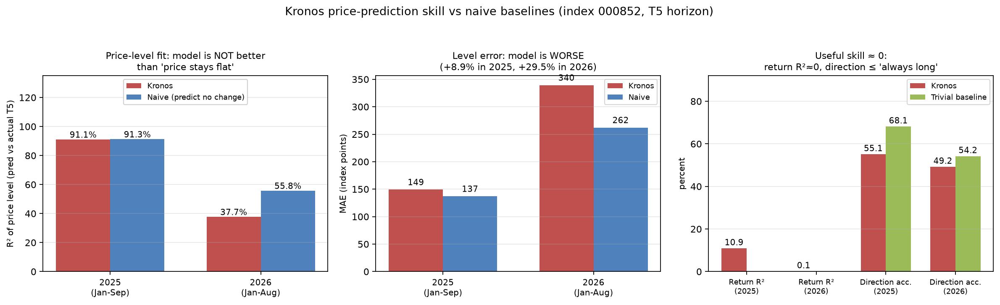

# Kronos A股择时策略系统

围绕中证 1000（000852），基于开源金融 K 线基础模型 [Kronos](https://github.com/shiyu-coder/Kronos)
构建的 A 股指数择时系统。覆盖行情数据采集、模型两阶段微调、滚动续训、批量 GPU 推理、
含成本 walk-forward 回测，到 FastAPI + React 的每日自动调度服务。

## 系统能力

**数据层** — 全 A 股目录与日线查询；AKShare 收盘快照增量更新，SQLite 幂等入库并与历史文件合并；
中证 1000 历史成分回填（CSMAR）；停牌、涨跌停、复权口径等 A 股规则校验。

**模型层** — 官方 Kronos 两阶段微调（tokenizer + predictor）；3 个月窗口 / 1 个月步长的逐月滚动续训，
支持中断后从 checkpoint 恢复；全 A 股批量 GPU 推理；月度概率校准。

**策略层** — 预测结果股票池筛选（概率、预期收益、ST、停牌、流动性、行业集中度）；
买入/持有/卖出信号与仓位、止损止盈风控；含佣金、印花税、滑点的 walk-forward 回测。

**服务层** — FastAPI 分层后端（45 个模块）；React + Vite 用户端与管理端；OpenAPI 文档；
工作日收盘后自动执行更新、预测、实际值回填、选股与信号流水线。

工程侧另有 23 个 pytest 测试文件覆盖各分层，生产部署由 systemd 托管。

## 评估与结论

全流程采用严格样本外协议：参数只用前一月验证集挑选，回测含佣金 0.03% 与滑点 0.1%，
模型为官方权重快照、不重训。

样本区间 2025-01~09 净收益 **+32.01%**（买入持有 +30.67%）。经三项检验后确认该结果**不可外推**：

- **样本外** — 同口径在 2026-01~08 转为净 −5.16%（买入持有 +0.21%），最大回撤由 −4.67% 恶化至 −16.01%
- **种子稳健性** — 仅更换随机种子，同一方案的收益在 +0.19%~+29.58% 之间摆动（σ = 15.2pp）；
  单次运行的数字携带的采样噪声已超过策略间的差异
- **基准对照** — 价格水平 R² 与 MAE 均劣于"预测价格不变"的朴素基准，方向准确率低于"永远猜涨"



**结论**：校正基准后无可用超额收益。该项目的主要产出是定位出论文所报预测精度的来源
——指数点位序列的自相关，而非预测能力。

完整实验记录见 [docs/训练记录/](docs/训练记录/)。

## 项目结构

```text
src/
├── common/          # 配置、日志、异常和通用工具
├── data_layer/      # A 股规则、下载、预处理、校验和存储
├── model_layer/     # Kronos 训练、推理、校准和模型适配
├── strategy_layer/  # 选股、信号、回测、优化和风控
├── service_layer/   # FastAPI 路由、模型和 Web 服务
└── scheduler/       # 每日数据与预测任务
scripts/             # 数据、训练、评估和运维 CLI，详见 scripts/README.md
tests/               # 与 src 分层对应的 pytest 测试，详见 tests/README.md
third_party/Kronos/  # Kronos 官方源码 + 本项目补丁
deploy/              # 服务器部署与发布工具，详见 deploy/README.md
docs/训练记录/        # 实验记录：样本外测试、种子稳健性、口径翻转、朴素基准对照
```

`data/`、`models/`、`logs/`、`tmp/` 为运行或生成内容，不作为代码发布目录。

## 快速启动

需要 Python 3.10+ 与 Node.js。

```bash
python -m venv venv
source venv/Scripts/activate          # Windows PowerShell: .\venv\Scripts\Activate.ps1
pip install -r requirements.txt

# 下载 Kronos 权重（公开，来自 Hugging Face）
python scripts/download_kronos.py

python -m uvicorn src.service_layer.web_server:app --host 127.0.0.1 --port 8000 --reload
```

新开终端启动前端：

```bash
cd frontend
npm install
npm run dev -- --host 127.0.0.1 --port 5173
```

访问 `http://127.0.0.1:5173`，API 文档在 `http://127.0.0.1:8000/docs`。完整步骤见 [QUICKSTART.md](QUICKSTART.md)。

**说明**：数据目录（`data/`）、模型权重（`models/`）与本地研究产物不入库，首次运行需先下载行情与权重。
系统只处理日线数据，不提供盘中实时行情。

## 验证

```bash
pytest -q -s tests

cd frontend
npx tsc -b --pretty false
npx vite build
```

## 文档索引

**评估与实验记录**

- [2026 年样本外测试](docs/训练记录/20260910_2026年样本外测试.md) — 样本外表现与多种子稳健性检验
- [最终定稿：Base + Spearman 月度选参](docs/训练记录/20260908_最终定稿_BaseSpearman.md) — 完整评估证据链

**复现与过程**

- [择时研究报告](docs/训练记录/20260908_Kronos择时_报告.md) — 复现过程与结果
- [实验过程归档](docs/训练记录/_实验过程/) — 口径对齐、超参扫描、成分审计等中间实验
