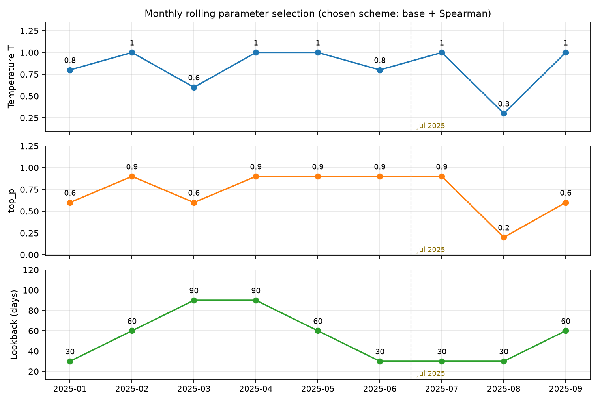
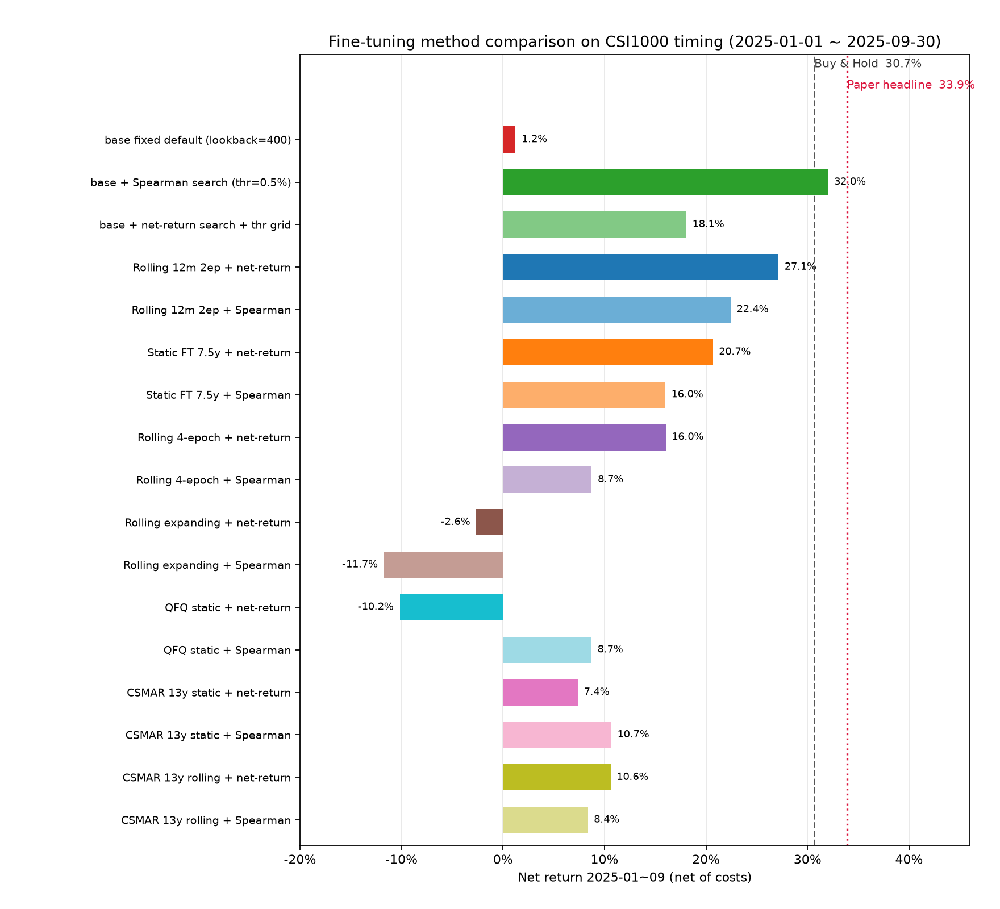
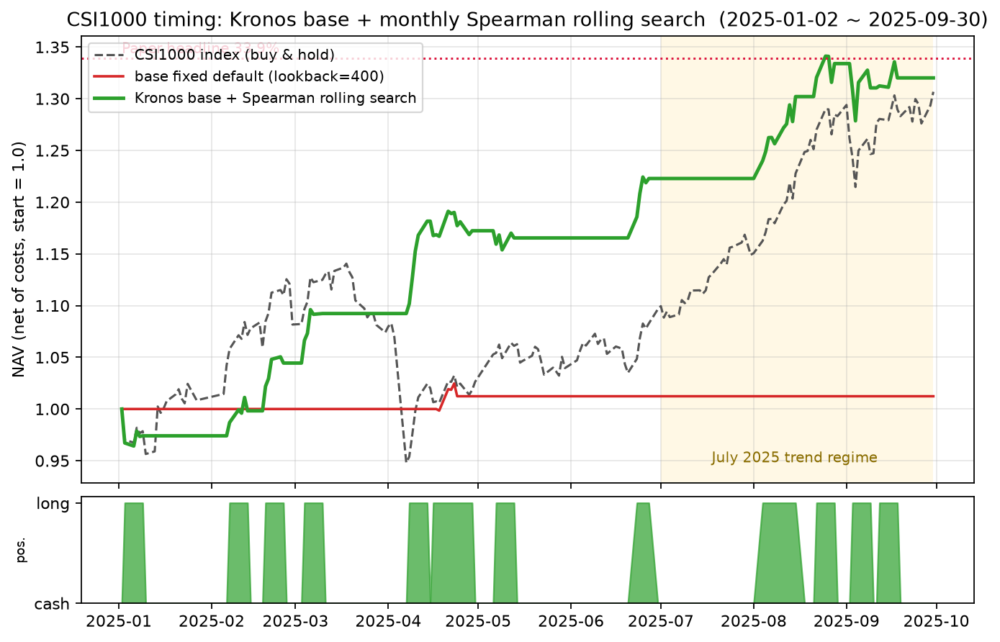
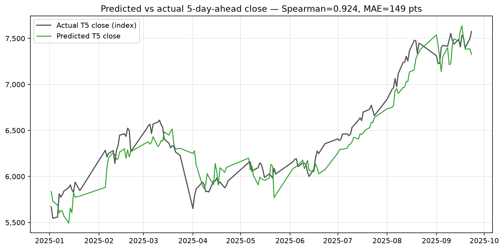
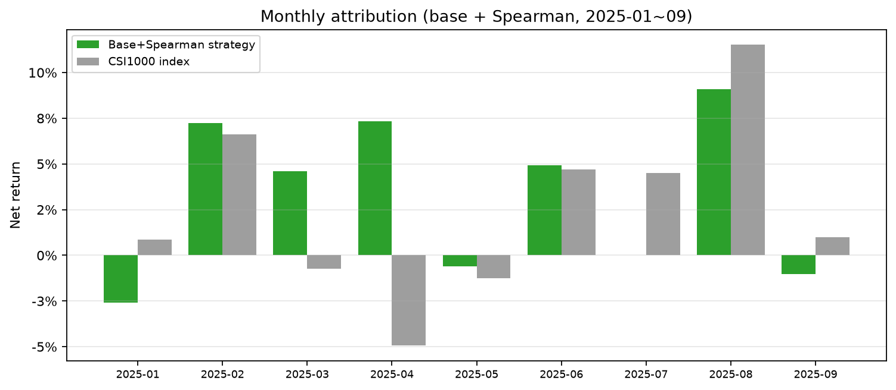
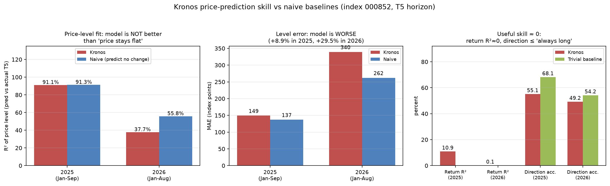
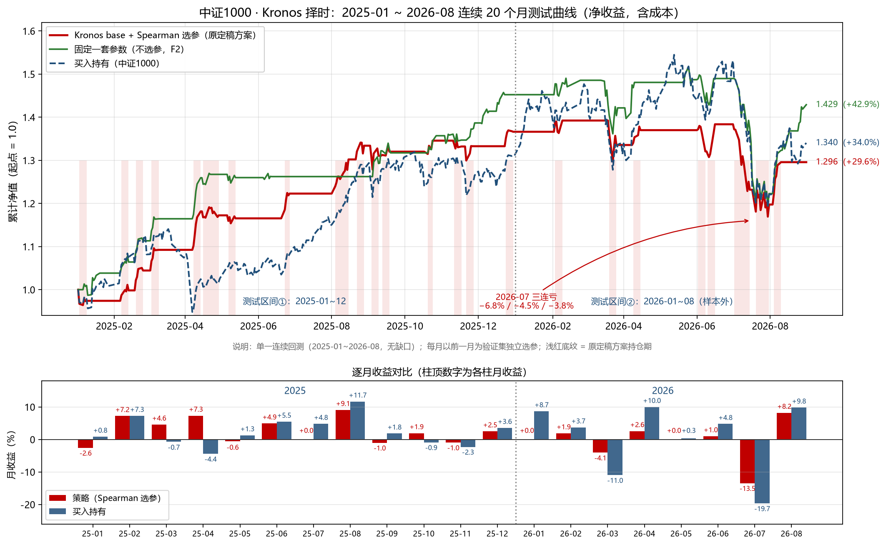
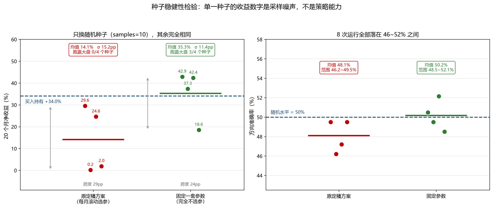
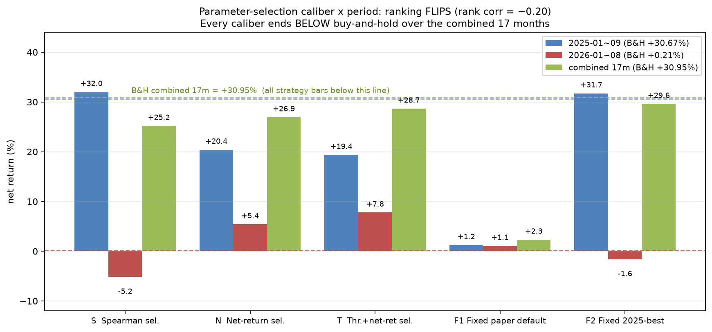

# 中证1000 · Kronos 大模型择时应用（复现实验报告）

## 摘要
- 16 个变体中**零样本 Kronos-base + 月度 Spearman 滚动选参**在原测试区间（2025-01~09）最优：净 **+32.01%**（毛 +36.91%），超额 **+1.03pp**；
- **但该结果不可外推**：① 模型价格预测能力经朴素基准检验后**不成立**（见"模型预测能力复核"）；② 2026 年新数据样本外测试**净 −5.16%**，跑输买入持有 5.36pp；③ 选参口径在 2025/2026 两区间**排名翻转**（排名相关 −0.20）；
- **补齐 2025-10~12 缺口后重跑连续 20 个月（2025-01~2026-08）**：买入持有 +34.04%，四口径单种子成绩为 +29.58% ~ +42.90%；
- **种子稳健性检验（每口径 4 个随机种子）修正了上述比较**：仅换种子，原定稿方案净收益在 **+0.19%~+29.58%**（σ=15.2pp）、固定参数在 **+18.57%~+42.90%**（σ=11.4pp）之间摆动。**原定稿方案 4 个种子全部跑输基准**（均值 −14.88pp）；固定参数均值 +35.30%（+0.94pp）**不构成可靠超额**；8 次运行的方向准确率 **全部落在 46.2%~52.1%**；
- 各类微调（静态/滚动/qfq/expanding/4ep/13y）均 ≤ 零样本；唯一有效微调 = 近12月窗口 + 2ep 滚动（净 +27.1%）；
- 论文 33.9% 未复现。

> **结论摘要**：本策略 2025 年的 +32.01% 是**单区间结果**。在连续 20 个月 + 4 个随机种子的检验下，**唯一稳健的结论是"该策略无方向能力、且原定稿方案在每个种子下都跑输买入持有"**；单一种子的收益数字（包括 +32.01%、+42.90%、−5.16%）都携带 ±15pp 量级的采样噪声，不可作为方案优劣的依据。**收益级 alpha ≈ 0**。

## 参数配置（对应中金研报图表13/16/17 口径）

### 图表A：择时策略构建参数（对应研报图表13）

| 项目 | 取值 |
|---|---|
| 交易标的 | 中证1000 指数（000852.SH） |
| 信号定义 | 预测收益率 = 未来第 5 日预测收盘价 ÷ 当前收盘价 − 1 |
| 做多触发 | 预测收益率 > 0.5% |
| 允许做空 | 否（long_only） |
| 信号生成时点 | T−1 日收盘后 |
| 建仓时点 | T 日开盘 |
| 持仓周期 | 固定 5 个交易日（期间新信号不调仓） |
| 仓位管理 | 满仓（100% 做多 / 空仓） |
| 交易成本 | 佣金 0.03% + 滑点 0.1%（ETF 免印花税） |
| 测试区间 | 2025-01-01 ~ 2025-09-30 |
| 执行价格 | 000852 日线点位（开盘建仓、第 5 日收盘平仓） |

### 图表B：模型与推理参数（选定方案 = 零样本 base）

| 项目 | 取值 |
|---|---|
| 模型 | NeoQuasar/Kronos-base（官方 2025-06-30 快照，不做微调） |
| 模型规模 | 102.3M 参数；d_model=832；12 层；16 头；max_context=512 |
| 分词器 | Kronos-Tokenizer-base：s1_bits=10、s2_bits=10（粗/细码各 2¹⁰=1024） |
| 输入特征 | open/high/low/close/volume/amount（6 维，窗口级 z-score 归一化） |
| 采样数 sample_count | 10 |
| 采样温度 T 网格 | {0.3, 0.6, 0.8, 1.0} |
| 核采样 top_p 网格 | {0.2, 0.4, 0.6, 0.9} |
| 回看窗口 lookback 网格 | {30, 60, 90} |
| 随机种子 | 100 |

### 图表C：滚动选参规则（对应研报图表17）

| 项目 | 取值 |
|---|---|
| 滚动粒度 | 1 个月 |
| 验证集 | 当前测试月的前 1 个月 |
| 搜索参数 | T × top_p × lookback（上述网格，48 组） |
| 择优指标 | 验证月预测价 Spearman（水平相关）最高 |
| 应用方式 | 选出的参数组套用于当月全部信号日 |
| 选参频率 | 每月滚动重复 |

### 图表D：对照实验的微调参数（对应研报图表16）

| 阶段/参数 | 取值 |
|---|---|
| 阶段一 Tokenizer | lr=2e-4；epochs=10；batch=30；60,000 窗口/epoch；early-stop patience=3 |
| 阶段二 Predictor | lr=1e-5；其余同阶段一（tokenizer 冻结） |
| 优化器 | AdamW：β=(0.9, 0.95)、weight_decay=0.1、OneCycleLR、grad-clip=3.0 |
| 训练窗口（静态） | 成分股目标 2015-06~2022（对齐版 2010~2022/CSMAR） |
| 滚动微调配方 | predictor-only + warm-start；训练窗口=近 12 个月；2 epochs/月（EP4=4）；每测试月重训 |
| 微调用数据 | 中证1000 时点成分（无幸存者偏差）693 只（CSMAR 版 2724 只），hfq（qfq 版对照） |
| 预测长度 / 回看 | horizon=5、lookback=250（训练）；推理 lookback 30/60/90（选参） |
| 报告对比口径 | 论文宣称 33.9%（图表21）；本报告全部净收益含成本 |

> 注：图表16/17 参数为论文原文口径；我们按图表16 全参微调并在图表17 网格上滚动搜参；**选定方案未使用任何微调**（图表B），仅用图表17 的滚动选参。

### 图表E：固定参数口径（对照组，不做任何月度选参）

报告中"S/N/T"为**每月滚动选参**口径，"F1/F2"为**固定参数**口径（20 个月里始终用同一组参数，不做任何搜索）。二者固定取值如下：

| 代号 | 含义 | 温度 T | top_p | 回看 lookback | 其余设置 |
|---|---|---|---|---|---|
| **F1** | 论文所述 base 零样本默认推理配置 | 0.6 | 0.9 | **400** | 完全相同：samples=10、做多阈值 0.5%、固定持有 5 个交易日、佣金 0.03% + 滑点 0.1%、持有期不调仓 |
| **F2** | 原定稿方案在 2025 年**被选中次数最多**的参数组合 | **1.0** | **0.9** | **60** | 同上 |

**F1 的来历**：lookback=400 是论文 base 零样本默认推理设置（正文"lookback 400 / T 0.6 / top_p 0.9 / 10 samples"）。由于回看窗口很长而触发条件严格，它在 20 个月里只成交 5 笔，几乎等同于空仓（2025 年净 +1.23%）。

**F2 的来历（重要）**：原定稿方案在 2025-01~09 的 9 个月中共选出 **8 种不同组合**，其中 **(T=1.0, top_p=0.9, lookback=60)** 出现 **2 次**（2025-02、2025-05），是出现次数最多的**完整组合**；若只看 (T=1.0, top_p=0.9) 则出现 4 次（lookback 分别为 60/90/60/30）。

> ⚠️ 因此 **F2 的取值来自 2025 年的选参结果，对 2025 区间属"轻度样本内"**，其对 2026 及之后才是干净先验。F2 与 F1 的区别**只有 T/top_p/lookback 三个推理参数**，模型、数据、交易规则、成本假设与 S/N/T 完全一致。

### 图表F：随机种子（本次稳健性检验的关键变量）

| 项目 | 取值 |
|---|---|
| 默认种子 | `seed=100`（原定稿、2026 测试、连续 20 个月均为此值） |
| 稳健性检验种子 | `seed=100 / 200 / 300 / 400`（原定稿方案与 F2 各跑 4 个） |
| 作用位置 | 控制模型每次预测的 10 条采样路径（`numpy` / `torch` 全局种子） |
| 实测影响 | 仅换种子，20 个月净收益摆动 **24~29pp**（σ ≈ 11~15pp）——见第（5）节 |

> 这是本次实验最重要的发现之一：**`samples=10` 时单次运行的收益数字带有十几到二十几个百分点的采样噪声**，任何"方案 A 比方案 B 高 X pp"的单次比较都可能只是种子差异。

## 选定模型参数速览

| 参数 | 值 |
|---|---|
| 模型 | Kronos-base（102.3M） |
| 每次预测采样 | 10 条路径 |
| 温度 T / top_p | 每月在 {0.3,0.6,0.8,1.0}×{0.2,0.4,0.6,0.9} 里挑 |
| 回看 lookback | 每月在 {30,60,90} 里挑 |
| 择优方式 | 上个月为验证，Spearman 最高者胜出 |
| 做多条件 | 预测 5 日后涨 > 0.5% |
| 持仓 | 固定 5 个交易日 |
| 成本 | 佣金 0.03% + 滑点 0.1% |

### 每月实际选出的参数

| 测试月 | T | top_p | lookback | 验证月 Spearman |
|---|---|---|---|---|
| 2025-01 | 0.8 | 0.6 | 30 | +0.547 |
| 2025-02 | 1.0 | 0.9 | 60 | +0.527 |
| 2025-03 | 0.6 | 0.6 | 90 | +0.538 |
| 2025-04 | 1.0 | 0.9 | 90 | +0.076 |
| 2025-05 | 1.0 | 0.9 | 60 | −0.118 |
| 2025-06 | 0.8 | 0.9 | 30 | +0.609 |
| 2025-07 | 1.0 | 0.9 | 30 | −0.171 |
| 2025-08 | 0.3 | 0.2 | 30 | +0.946 |
| 2025-09 | 1.0 | 0.6 | 60 | +0.938 |

**怎么读这张表/图**：9 个月里参数每个月都在变——1–3 月多用中等回看（60/90），5 月起逐步切到 30 天短线窗口，8 月甚至同时把温度压到 0.3（更"保守"的采样）。这就是"滚动选参"：没有一套固定参数，而是每月根据上一月的表现临时换。⚠️ 它的水分也在这：参数是**回头看历史挑出来的**，真实外推时会打折扣。

## 方案名称解释
- **零样本 base**：官方预训练模型直接择时，不微调；
- **静态微调**：固定训练期一次性两阶段 10ep；
- **滚动微调**：每月用近 12 月窗口对 predictor 2ep warm-start 重训、逐月换模型；
- **warm-start**：以上月/静态 checkpoint 初始化续训；
- **12m / expanding**：滚动训练窗口只取近 12 月 / 全历史扩到当前；
- **EP4**：滚动每月 4 epoch（过拟合，弃）；
- **qfq / hfq**：前复权 / 后复权口径；
- **CSMAR 13y**：国泰安回填 2010–2014 成分、训练期对齐 13 年；
- **Spearman / net_return 选参**：验证月按预测价 Spearman / 策略净收益择优；
- **阈值网格**：把 0.5% 开仓阈值也加入验证网格（改进对照）；
- **T/top_p/lookback**：采样温度/核截断/回看窗口，逐月网格择优。

## 全部微调方法对比（净收益，含成本）

| 方案 | 净收益 | 方向准确率 |
|---|---|---|
| **base + Spearman（选定）** | **+32.01%** | 55.1% |
| base + net_return + 阈值网格 | +18.06% | 52.2% |
| **base 固定默认参数（不选参，lookback=400）** | **+1.23%** | 30.4% |
| 滚动 12m 2ep + net_return | +27.14% | 47.8% |
| 滚动 12m 2ep + Spearman | +22.42% | 44.2% |
| 静态 7.5y + net_return | +20.67% | 50.0% |
| 静态 7.5y + Spearman | +15.99% | 42.8% |
| 滚动 4ep + net_return | +16.02% | 40.6% |
| 滚动 4ep + Spearman | +8.74% | 39.9% |
| 滚动 expanding + net_return | −2.63% | 41.3% |
| 滚动 expanding + Spearman | −11.73% | 34.8% |
| qfq 静态 + net_return | −10.18% | 39.9% |
| qfq 静态 + Spearman | +8.71% | 43.5% |
| CSMAR 13y 静态 + net_return | +7.36% | 44.2% |
| CSMAR 13y 静态 + Spearman | +10.67% | 47.1% |
| CSMAR 13y 滚动 + net_return | +10.60% | 43.5% |
| CSMAR 13y 滚动 + Spearman | +8.35% | 39.1% |
| 买入持有 | +30.67% | — |
| 论文宣称 | 33.9% | — |

## 选定方案：base + Spearman
- 净值曲线（含持仓色条、论文 33.9% 参考线、7 月趋势底纹）：
  
- 预测 vs 真实 T5 收盘价：
  
- 月度归因：
  

关键指标：净 +32.01% / 毛 +36.91% / 超额 +1.03pp / 年化 46.89% / 波动 12.74% / Sharpe 3.07 / 最大回撤 −4.67% / 交易 14 次 / 胜率 71.4% / 在市值率 38.3% / T5 Spearman 0.924 / 方向准确率 55.1%。

## 模型预测能力复核（对照朴素基准）

原报告"预测精度复现成功（Spearman 0.92）"这一说法**需要修正**。加入朴素基准——即"预测 5 天后价格 = 今天价格"（什么都不预测）——对比后：

| 指标 | 模型（2025） | 朴素基准（2025） | 模型（2026） | 朴素基准（2026） |
|---|---|---|---|---|
| 价格水平 R² | 0.9113 | **0.9130** | 0.3775 | **0.5582** |
| 价格水平 MAE | 149.33 点 | **137.14 点** | 339.50 点 | **262.24 点** |
| 水平 Spearman | 0.9241 | **0.9283** | 0.6045 | **0.7014** |
| 收益级 R² | 0.1088 | — | **0.00068** | — |
| 方向准确率 | 55.07% | **68.12%**（永远猜涨） | 49.17% | **54.17%**（永远猜涨） |

**三条结论**：

1. **"Spearman 0.92"没有含金量**：一个"预测价格不动"的傻瓜模型拿到 0.9283，**高于** Kronos 的 0.9241；MAE 也比模型小 8.9%（2026 年更是小 29.5%）。原因是**指数点位序列高度自相关**（近似随机游走），任何"输出接近当前价"的做法都能拿到 0.9+。这不是预测能力，是价格序列的记忆性。
2. **真正有用的收益级能力 ≈ 0**：2025 年收益 R²=0.109（弱），2026 年 R²=**0.0007**（不到千分之一）。
3. **方向能力低于最笨的基准**：两年方向准确率（55.1% / 49.2%）均低于"永远猜涨"（68.1% / 54.2%）——模型系统性偏空（2026 只猜 35% 涨，实际 54% 涨）。

> 机理：价格 P_t 近似随机游走时，**水平相关**衡量"预测值离当前价多近"（只要≈当前价就得高分），**收益相关**衡量"对增量的预测"（真信号）。Kronos 在前者极高、后者≈0——这就是"看起来很强、实际不赚钱"的全部原因。此外推理用 `samples=10` 取平均会把输出拉向条件均值（≈当前价），进一步削弱微弱增量信号。

## 样本外检验与参数口径稳健性（2026 年新数据）

用 2026 年数据（指数日线已覆盖至 2026-09-01）对同一方案做**严格样本外**复跑：模型不变（官方 base 快照 2025-06-30）、规则不变、参数仅用前一月验证集挑选。2026-09 因缺少 T+5 未来价格无法形成信号，实际评估区间 2026-01~08。

### （1）原定稿方案失败

| 指标 | 2025-01~09 | **2026-01~08** |
|---|---|---|
| 净收益 | +32.01% | **−5.16%** |
| 买入持有 | +30.67% | +0.21% |
| 净超额 | +1.03pp | **−5.36pp** |
| 笔数 / 胜率 | 14 / 71.4% | 10 / **50.0%** |
| 方向准确率 | 55.1% | 49.2% |
| 最大回撤 | −4.67% | **−16.01%** |

亏损集中在 2026-07：连续三笔大亏（−6.81%、−4.46%、−3.84%），而模型当时预测的是 **+1.77%/+3.24%/+4.02%**，实际 −6.57%/−4.22%/−3.59%。

### （2）重跑连续 20 个月（补齐 2025-10~12 缺口）

原测试区间 2025-01~09 与 2026-01~08 之间缺了 2025-10~12 三个月。为彻底消除缺口与拼接，直接重跑**单一连续回测 2025-01 ~ 2026-08（20 个月）**，四口径同时连续（同一模型、同规则、每月以前一月为验证集）。买入持有同期 **+34.04%**。

| 口径 | 净收益 | 超额 | 笔数 | 胜率 | 方向准确率 | 最大回撤 | 在市率 |
|---|---|---|---|---|---|---|---|
| **F2 固定一套参数（T1.0/p0.9/lb60，不选参）** | **+42.90%** | **+6.61pp** | 32 | 71.9% | 50.5% | −21.28% | 39.7% |
| T 阈值并入网格 + 净收益选参 | +34.99% | +0.71pp | 35 | 68.6% | 50.5% | −17.71% | 43.4% |
| N 净收益选参 | +32.81% | −0.91pp | 37 | 67.6% | 51.8% | −20.42% | 45.9% |
| **S Spearman 选参（原定稿方案）** | **+29.58%** | **−3.33pp** | 28 | 64.3% | 49.5% | −16.01% | 34.7% |

**原定稿方案在四条口径里排最后**，且是唯一显著跑输买入持有的一条。四条的**方向准确率全部在 49.5%~51.8%**——"无方向能力"这一结论在 20 个月样本上依然成立。

> ⚠️ 本表四个数字均来自**单一随机种子（seed=100）**。第（5）节多种子检验显示种子噪声达 ±15pp，故本表只用于展示"同一模型下不同用法的量级"，**不可用于判定口径优劣**。

### （3）缺口三个月的表现（首次测到）

| 区间 | 策略（S 方案） | 买入持有 | 差 |
|---|---|---|---|
| 2025-01~09（原测试区间） | +32.01% | +30.67% | +1.34pp |
| **2025-10~12（原缺口，本次补齐）** | **+3.49%** | **−0.69%** | **+4.18pp** |
| 2026-01~08（样本外） | −5.16% | +0.21% | −5.37pp |

缺口三个月恰好是**有利区间**（策略 +3.49%，大盘 −0.69%）：2025-10 策略 +1.94%（大盘 −0.90%）、2025-11 −0.96%（大盘 −2.30%）、2025-12 +2.52%（大盘 +3.56%）。因此补齐后 S 的 20 个月结果由拼接版的 +25.20% 升到 **+29.58%**——但**仍跑输买入持有 3.33pp**。

### （4）2025—2026 连续测试曲线

| 曲线 | 20 个月末净值 | 累计净收益 |
|---|---|---|
| 固定一套参数（T1.0/p0.9/lb60，不选参） | 1.429 | **+42.90%** |
| 买入持有（中证1000） | 1.340 | +34.04% |
| Kronos base + Spearman 选参（原定稿方案） | 1.296 | +29.58% |

曲线要点：① 单一连续回测，无缺口、无拼接；② 浅红底纹为原定稿方案持仓期，可见其大部分时间空仓（在市率 34.7%）；③ 2026 年 7 月连续三笔亏损（−6.81%/−4.46%/−3.84%）是主要回撤来源，而模型当时预测的是 **+1.77%/+3.24%/+4.02%**（完全看反）；④ 三条曲线终点：**原定稿方案最低**，固定参数最高。

### （5）种子稳健性检验：单一种子的收益数字是噪声

上面的口径比较都基于**单一随机种子（seed=100）**。为检验这些数字是否稳定，把原定稿方案与固定参数各用 **4 个种子（100/200/300/400）** 重跑连续 20 个月（其余设置完全相同）：

**原定稿方案（Spearman 选参）**

| seed | 净收益 | 超额 | 笔数 | 胜率 | 方向准确率 | 回撤 |
|---|---|---|---|---|---|---|
| 100 | +29.58% | −3.33pp | 28 | 64.3% | 49.5% | −16.01% |
| 200 | +0.19% | −25.25pp | 30 | 63.3% | 46.2% | −21.99% |
| 300 | +24.64% | −7.01pp | 33 | 63.6% | 47.2% | −14.65% |
| 400 | +1.97% | −23.93pp | 31 | 64.5% | 49.5% | −22.76% |
| **均值±σ** | **+14.09% ± 15.18pp** | **−14.88pp** | — | 63.9% | 48.1% | −18.85% |

**固定参数（T1.0/p0.9/lb60，不选参）**

| seed | 净收益 | 超额 | 笔数 | 胜率 | 方向准确率 | 回撤 |
|---|---|---|---|---|---|---|
| 100 | +42.90% | +6.61pp | 32 | 71.9% | 50.5% | −21.28% |
| 200 | +37.34% | +2.46pp | 31 | 67.7% | 49.5% | −19.70% |
| 300 | +42.38% | +6.22pp | 33 | 72.7% | 52.1% | −24.11% |
| 400 | +18.57% | −11.54pp | 31 | 64.5% | 48.5% | −20.64% |
| **均值±σ** | **+35.30% ± 11.43pp** | **+0.94pp** | — | 69.2% | 50.2% | −21.43% |

买入持有 = **+34.04%**。

**四条修正性结论（重要）**：

1. **种子噪声极大**：仅换随机种子，原定稿方案净收益就在 **+0.19% ~ +29.58%** 之间摆动（跨度 **29.4pp**，σ=15.2pp）；固定参数在 **+18.57% ~ +42.90%** 之间（跨度 24.3pp，σ=11.4pp）。**噪声量级 ≥ 我们此前讨论的口径差异量级**，因此**§(2) 中"F2 比 S 高 13.3pp"这类单种子比较不足以作为结论**。
2. **唯一稳健的结论：原定稿方案在 4 个种子下全部跑输买入持有**（0/4 跑赢，超额 −3.33pp ~ −25.25pp，均值 −14.88pp）。这比单种子时的"−3.33pp"严重得多。
3. **固定参数并不真的跑赢基准**：均值仅 +0.94pp，4 个种子中 3 正 1 负，跨度横跨 0；此前"跑赢 6.61pp"是种子里较乐观的一次。
4. **方向能力无：8 次运行（两口径 × 4 种子）的方向准确率全部落在 46.2% ~ 52.1%，均值 48.1% / 50.2%**，围绕 50% 波动。这是本次所有实验中最稳健的一条结论。

**配对比较**（同种子下 F2 − S，可消除共同噪声）：逐种子差 +13.32/+37.14/+17.74/+16.60pp，均值 **+21.20pp**；配对 t 检验 **t=3.93, p=0.029**（n=4）；非配对 t 检验 t=2.23, p=0.071。即"固定参数优于滚动选参"在配对意义下**勉强显著**，但样本极小（4 个种子），应视为提示性证据而非定论。

> 方法论教训：本项目此前所有"方案 A 比方案 B 高 X pp"的单种子比较，都应带上"±15pp 量级的种子噪声"。后续任何结论都需要多种子平均，或显著提高 `samples`（当前 10）以降噪。

### （6）两个致命观察（结合种子噪声重新审视）

1. **口径排名随区间翻转**（2025 与 2026 的排名相关 **−0.20**，负值）：

| 排名 | 2025 区间 | 2026 区间 |
|---|---|---|
| 1 | S Spearman **+32.01%** | T 阈值+净收益 **+7.78%** |
| 2 | F2 固定 +31.73% | N 净收益 +5.43% |
| 3 | N 净收益 +20.40% | F1 固定 +1.08% |
| 4 | T 阈值+净收益 +19.36% | F2 固定 −1.60% |
| 5 | F1 固定 +1.23% | **S Spearman −5.16%** |

   2025 让 Spearman 看起来最优，2026 又把它打到最差。**"哪条口径最好"由区间决定，属噪声而非真实优势**——这正是无 edge 的教科书特征。

2. **"不做任何选参反而最好"这一条，被种子检验显著削弱**：F2 在 seed=100 下拿到 +42.90%（比原方案高 13.3pp、比基准高 6.61pp），但**4 个种子的均值为 +35.30%（σ=11.4pp），仅略高于买入持有 +34.04%**，且其中 seed=400 为 +18.57%（跑输基准 11.5pp）。因此**F2 的绝对水平不构成对基准的可靠超额**；能保留的只是"配对比较下 F2 优于 S"（同种子均值差 +21.2pp，配对 t 检验 p=0.029，n=4，提示性证据）。

> 诚实性声明：① 在同一 2026 区间上比较多种口径属事后比较，存在数据窥探风险；因此 N/T/F2 均补跑了 2025 区间、连续 20 个月与 4 个随机种子，各区间/各种子结果一并披露。② F2 的参数（T1.0/top_p0.9/lookback60）是按"2025 年被 Spearman 选中次数最多"倒推的，对 2025 属**轻度样本内**。③ 所有单种子比较都带 **±15pp 量级的种子噪声**，两区间排名负相关进一步说明不能据此挑"更好的口径"。

## 结论与风险提示
1. **收益级 alpha ≈ 0**：收益 R² 2025 年 0.109、2026 年 0.0007；**8 次多种子运行的方向准确率全部落在 46.2%~52.1%**（≈随机）；"Spearman 0.92"被价格自相关支配、低于朴素基准 0.9283；
2. **2026 年严格样本外失败**：原定稿方案净 −5.16%（跑输基准 5.36pp）；
3. **原定稿方案在所有 4 个随机种子下均跑输买入持有**（连续 20 个月：超额 −3.33pp ~ −25.25pp，均值 −14.88pp）——这是本次最稳健的结论；
4. **单种子数字不可用作方案比较**：仅换种子，收益就在 ±15pp（σ）范围内摆动（原方案 +0.19%~+29.58%）。此前"+32.01%""+42.90%""跑赢基准 6.6pp"等表述均须据此打折；固定参数 4 种子均值 +35.30% 对基准（+34.04%）**无可靠超额**；
5. **月度滚动选参机制无证据支持其价值**：配对比较下它劣于"固定一套参数"（均值差 +21.2pp，配对 t 检验 p=0.029），但该结论基于 4 个种子，属提示性证据；
6. **收益 33.9% 未复现**，且"复现 33.9%"本身不是有意义的目标——模型不提供可用的方向 alpha；
7. **可用的结论**：Kronos 是一个像样的**价格路径/形态模拟器**（水平轨迹贴合度极高），但**不能作为方向与收益 alpha 来源**；
8. **方法论教训**：本项目几乎所有"方案 A 比方案 B 高 X pp"的结论都建立在单种子之上，而该量级的噪声（±15pp）足以吞掉全部差异。任何后续工作必须先做多种子平均或提高 `samples`。

> 免责声明：历史回测仅供研究，不构成投资建议。模型为 NeoQuasar/Kronos-base 官方 2025-06-30 快照（哈希已核）。
