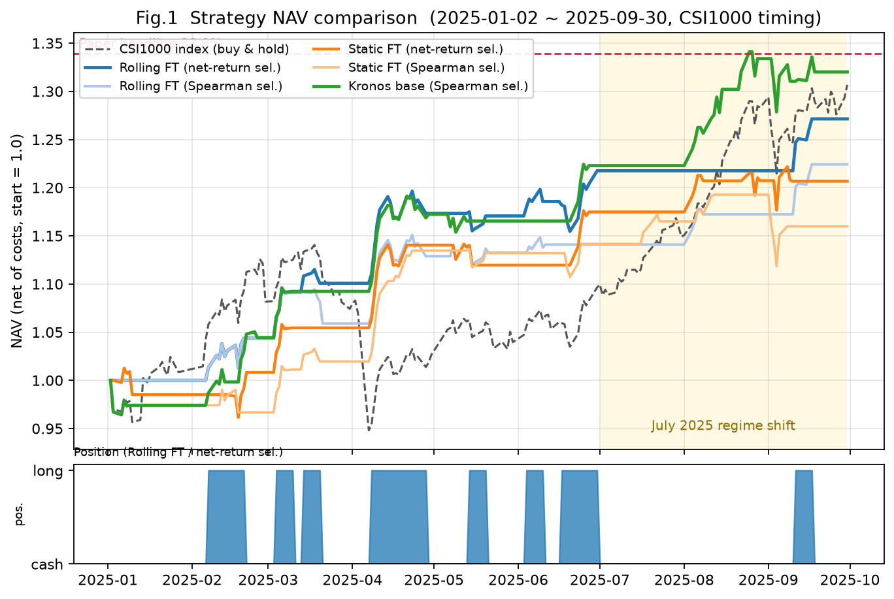
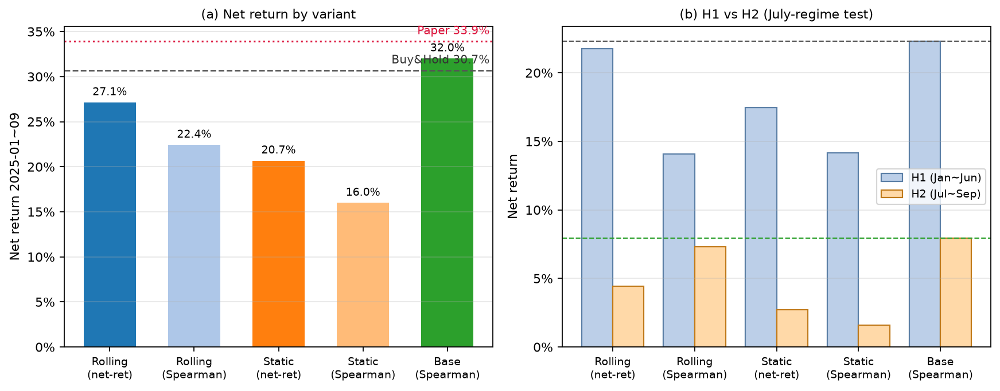
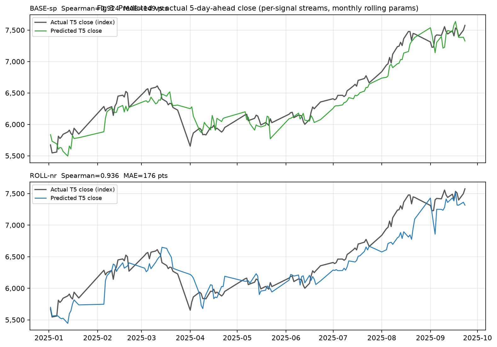
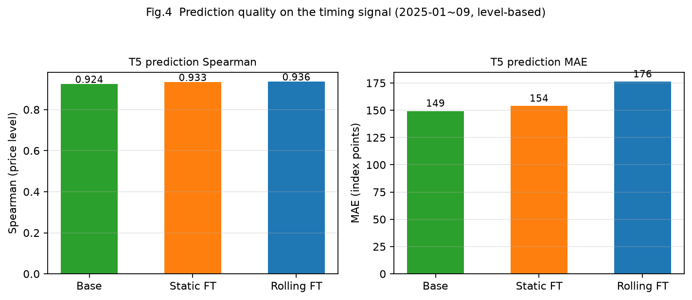

# 中证1000 · Kronos 择时对比报告（论文风格图）

> 2026-09-07 ｜ 完整交互版：`20260907_滚动微调对比报告.html`（自包含，双击浏览器打开）
> 图文件：`figs_20260907/fig1~fig4_*.png`

## 摘要
- 滚动微调全面优于静态微调：净 +22.4%~+27.1% vs +16.0%~+20.7%（2025-01~09，含成本）；
- **H2（7 月后）**：滚动 spearman +7.30% vs 静态 +1.59%（+5.7pp）——论文"定期微调提升 7 月后趋势敏感度"方向验证成立；
- 最优滚动净 +27.1%（毛 +31.2%），**未达论文 33.9%**；零样本 base 净 +32.0%/毛 +36.9% 最接近（方向准确率 55.1% 最高）；
- 水平 Spearman 0.92~0.94 三方案几乎无差 → 差异在交易侧行为而非水平拟合。

## 图
1. **净值对比曲线**（对应论文图表21，含持仓/空仓色条、2025-07 底纹、论文 33.9% 参考线）：
   
2. **净收益柱状 + H1/H2 拆解**：
   
3. **预测 vs 真实 T5 收盘价序列**（base / 滚动 / 静态）：
   
4. **T5 预测 Spearman 与 MAE**（对应论文图表18 口径）：
   

## 汇总表（2025-01-01 ~ 2025-09-30，B&H +30.67%）
| 方案 | 毛 | 净 | 胜率 | 方向准确率 | 净超额 |
|---|---|---|---|---|---|
| Rolling FT (net-return) | +31.17% | **+27.14%** | 83.3% | 47.8% | −2.70pp |
| Rolling FT (Spearman) | +26.30% | +22.42% | 75.0% | 44.2% | −6.31pp |
| Static FT (net-return) | +23.85% | +20.67% | 80.0% | 50.0% | −7.65pp |
| Static FT (Spearman) | +19.35% | +15.99% | 72.7% | 42.8% | −11.24pp |
| Kronos base (Spearman) | +36.91% | **+32.01%** | 71.4% | **55.1%** | **+1.03pp** |
| 论文（图表21） | — | 33.9% | — | — | 年化超额 9% |

## 结论
1. 滚动微调机制方向验证成功（H2 +5.7pp），但本原型（2-epoch/近12月/predictor-only）不足以复现 33.9%；
2. base 零样本最接近论文数值（净 +32.0%），是"非论文对照"；
3. 剩余差距候选：滚动重训超参未披露、训练期缺 2010–2014、qfq 口径、33.9% 毛/净归属。
